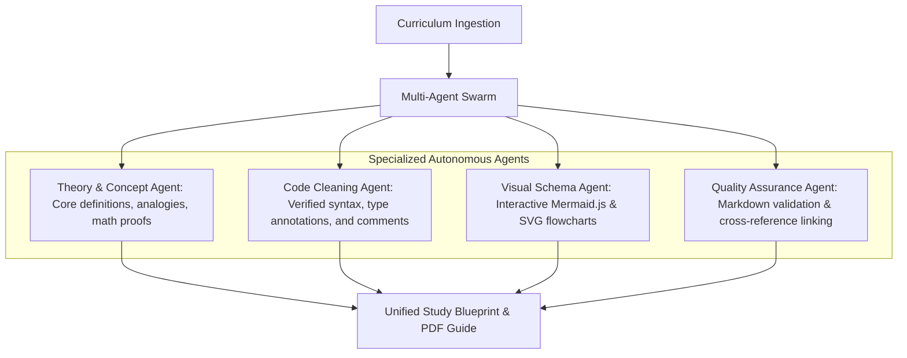

# Placements Guide • Masterclass Engineering Blueprints & Study Hub

> **Comprehensive Interview Preparation Blueprints & Masterclass Study Notes**  
> Covering DBMS, Operating Systems, Computer Networks, Machine Learning, Deep Learning, NLP, NeetCode 150, and Agentic AI.  
> Live Deployment: [placements-guide.vercel.app](https://placements-guide.vercel.app/)  
> Sibling to [4 U By U Workspace](https://4ubyu.vercel.app/) and [R-Prep Suite](https://r-prep.vercel.app/).

---

## 📚 Masterclass Study Subjects

| Module | Core Topics Covered | Format |
|---|---|---|
| **DBMS** (`/dbms`) | ACID properties, ER diagrams, Normalization (1NF-BCNF), Indexing (B+ Trees), Concurrency Control, SQL execution engines | 49-Page Scrollable PDF Guide + Markdown Reader |
| **Operating Systems** (`/os`) | Process management, CPU Scheduling, Virtual Memory, Paging/Segmentation, Deadlocks, File Systems | Interactive Study Blueprint |
| **Computer Networks** (`/cn`) | OSI & TCP/IP models, Flow/Error Control, Subnetting, Routing (Dijkstra, Bellman-Ford), DNS/HTTP/HTTPS/WebSocket | High-Yield Interview Reference |
| **Machine Learning** (`/ml`) | Mathematical foundations, Supervised/Unsupervised models, Loss functions, Regularization, Optimization | End-to-End Course Guide |
| **Deep Learning** (`/deeplearning`) | Backpropagation, CNNs, RNNs, LSTMs, Transformers, Attention Mechanisms | Technical Deep-Dive |
| **NLP** (`/nlp`) | Tokenization, Word Embeddings, BERT, GPT, Attention, Evaluation metrics (BLEU, ROUGE) | Comprehensive Engineering Notes |
| **NeetCode 150** (`/neetcode`) | Top 150 LeetCode patterns: Two Pointers, Sliding Window, Trees, Graphs, DP | Code & Complexity Analysis |
| **Agentic AI** (`/agentic-ai`) | LangChain & LangGraph architectures, Memory reducers, Tool orchestration, Multi-Agent swarms | Practical Implementation Guide |

---

## 🤖 Multi-Agent Synthesis Architecture

Every masterclass note and guide in this repository was synthesized using the **4 U By U Multi-Agent Swarm Pipeline**:



1. **Theory & Concept Synthesis**: Ensures rigorous definitions, mathematical formulations, and visual analogies without superficial summarization.
2. **Code Linting & Verification**: Produces executable, idiomatic code snippets with syntax highlighting.
3. **Visual Architecture Generation**: Automatically translates relational dependencies and workflows into Mermaid diagrams and vector schematics.
4. **Pedagogical Structuring**: Organizes notes into clear chapters with reading time estimates, cheat-sheets, and interview Q&A blocks.

---

## 🚀 Features

- **Interactive Reader Mode**: Dark-mode academic aesthetic tailored for long study sessions.
- **Scrollable & Printable PDF Alignment**: Precise 1-to-1 correspondence with source masterclass slides.
- **Syntax Highlighting**: Code blocks formatted with Prism.js and Fira Code typography.
- **100% Mobile Responsive**: Document-level fluid scrolling and collapsible navigation across all screen sizes.
- **Zero Cost & Open Access**: Free, open-source educational material for university students and software engineers.

---

## 📁 Repository Structure

```text
Placements/
├── index.html            # Main Portal & Subject Directory
├── dbms/                 # Database Management Systems Masterclass (49 pages)
│   └── index.html
├── os/                   # Operating Systems Masterclass
│   └── index.html
├── cn/                   # Computer Networks Masterclass
│   └── index.html
├── ml/                   # Machine Learning Engineering Blueprint
│   └── index.html
├── deeplearning/         # Deep Learning & Neural Architectures
│   └── index.html
├── nlp/                  # Natural Language Processing Blueprint
│   └── index.html
├── neetcode/             # NeetCode 150 Problem-Solving Blueprint
│   └── index.html
├── agentic-ai/           # Agentic AI, LangChain & LangGraph Handbook
│   ├── index.html
│   ├── langchain.html
│   └── langgraph.html
└── vercel.json           # Vercel deployment routing configuration
```

---

## 🌐 Deployment
Deploys automatically to **Vercel** via GitHub integration:
```bash
git add .
git commit -m "docs: add comprehensive placement guide and multi-agent synthesis overview"
git push origin master
```
